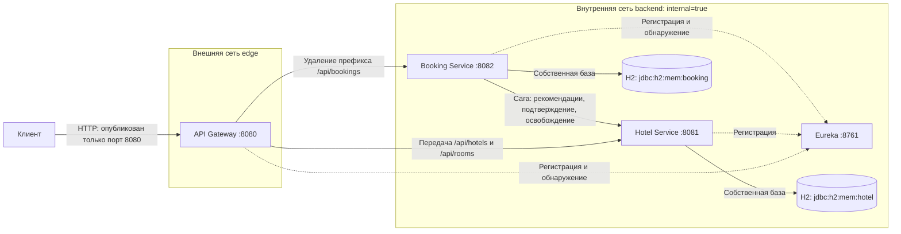

# Система бронирования отелей

REST API на Java 17 и Spring Boot 3.5.16: каталог отелей и номеров, регистрация и вход по JWT, бронирование и отмена, рекомендации и статистика загрузки. Проект состоит из четырёх самостоятельных приложений; сборкой управляет корневой `pom.xml`.

| Сервис | Назначение |
| --- | --- |
| `eureka-server` | Реестр экземпляров сервисов для их обнаружения по имени |
| `api-gateway` | Вход для клиентских запросов, маршрутизация, запрет внутренних операций, передача идентификатора трассировки |
| `hotel-service` | Отели, номера, интервалы занятости, рекомендации и статистика |
| `booking-service` | Пользователи, JWT, бронирования и оркестрация саги с сервисом отелей |

## Требования к окружению

Для локального запуска нужны JDK **17**, Maven **3.9.x** и четыре терминала. Для изолированного развёртывания нужны Docker Engine и плагин Docker Compose с командой `docker compose` (v2 или новее). Для примеров запросов нужны Bash, `curl` и `jq`; для генерации секретов — OpenSSL. 

Все команды выполняются из корня проекта. В каждом терминале с Java выберите JDK 17:

```bash
export JAVA_HOME=/path/to/jdk-17
export PATH="$JAVA_HOME/bin:$PATH"
java -version
mvn -version
```

Замените `/path/to/jdk-17` реальным путём. Обе команды проверки версии должны показывать Java 17. Maven загружает зависимости при первой сборке.

## Сборка, тесты и качество кода

```bash
mvn clean verify
```

Команда пересобирает все модули, запускает тесты, создаёт исполняемые JAR и проверяет форматирование и правила линтера. Ожидаемое завершение — `BUILD SUCCESS`; отчёты тестов находятся в `target/surefire-reports/<UUID>-<номер>/` каждого модуля. Запущенные приложения не нужны: тесты используют отдельные контексты, базы H2 и управляемые HTTP-заглушки. Для интеграционных тестов должна быть разрешена работа с локальными сетевыми сокетами.

| Команда | Действие | Изменяет исходники |
| --- | --- | --- |
| `mvn spotless:apply` | Применяет Google Java Format, упорядочивает импорты и удаляет неиспользуемые | **Да** |
| `mvn spotless:check` | Проверяет форматирование | Нет |
| `mvn checkstyle:check` | Проверяет соглашения об именах и длину методов | Нет |
| `mvn verify` | Собирает проект, запускает тесты и обе проверки | Нет |
| `mvn test` | Запускает тесты без проверок, привязанных к фазе `verify` | Нет |

Проверки охватывают  Java-файлы приложения и тестов во всех четырёх модулях. Сгенерированный код и каталоги `target` исключены. Нарушение формата или правил линтера завершает проверку с ошибкой. Запуск JAR и контейнеров **не запускает** форматтер, линтер или тесты.


### Общий итог тестов

После завершения всех четырёх сервисных модулей команды `mvn verify` и `mvn clean verify`, запущенные из корня проекта, автоматически выводят одну общую строку:

```text
Total tests: <число> | Failures: <число> | Errors: <число> | Skipped: <число>
```

При ошибке сборки, пропуске тестов, выборе отдельных тестов через `-Dtest=...`, фильтрах или частичном реакторе через `-pl` итог помечается `INCOMPLETE` с причиной. 

## Изоляция баз данных в тестах

Каждый Spring-тестовый класс бизнес-сервиса получает свою H2 в памяти с адресом `jdbc:h2:mem:test_<UUID>`. Повторное создание контекста создаёт новую базу. Разные классы не делят контекст даже при одинаковых настройках Spring. Модульные тесты с заглушками не создают БД без необходимости.


## Режимы запуска

По умолчанию, без явно выбранного профиля, используются настройки разработки из `src/main/resources/application.yml` каждого сервиса. Изолированное развёртывание использует `compose.prod.yml` и профиль Spring `prod` с настройками из `application-prod.yml`.

| Свойство | Разработка: локальные процессы Java | Изолированный режим `prod`: Docker Compose |
| --- | --- | --- |
| Gateway | `http://localhost:8080` | `http://localhost:8080` по умолчанию |
| Прямой доступ к Hotel и Booking | Порты `8081` и `8082` доступны | Порты не опубликованы на хосте |
| Eureka | `http://localhost:8761` | Доступна только во внутренней сети |
| H2 Console | Включена у бизнес-сервисов | Выключена |
| Swagger UI и OpenAPI | Включены у бизнес-сервисов | Выключены |
| JWT и внутренний ключ | Демонстрационный JWT-секрет в конфигурации; внутренний ключ можно переопределить через `INTERNAL_API_KEY` | Обязательные внешние `JWT_SECRET` и `INTERNAL_API_KEY` |
| Хранение данных | H2 в памяти каждого бизнес-сервиса | H2 в памяти каждого бизнес-сервиса |

**Профиль `prod` сам по себе не закрывает порты.** Сетевую границу создаёт Docker Compose: сервисы Hotel, Booking и Eureka подключены только к сети `backend` с `internal: true`, а Gateway — к сетям `backend` и `edge`. Только Gateway публикует порт на хосте. Администратор Docker-хоста остаётся доверенным и может обращаться к сетям контейнеров.

### Запуск разработки

Запустите команды по порядку, каждую в отдельном терминале из корня проекта. Дождитесь сообщения `Started` перед запуском следующего приложения.

| Порядок | Сервис | Порт | Команда |
| --- | --- | --- | --- |
| 1 | Eureka | 8761 | `java -jar eureka-server/target/eureka-server-1.0.0.jar` |
| 2 | Hotel | 8081 | `java -jar hotel-service/target/hotel-service-1.0.0.jar` |
| 3 | Booking | 8082 | `java -jar booking-service/target/booking-service-1.0.0.jar` |
| 4 | Gateway | 8080 | `java -jar api-gateway/target/api-gateway-1.0.0.jar` |

Откройте [реестр Eureka](http://localhost:8761) и дождитесь регистрации `HOTEL-SERVICE`, `BOOKING-SERVICE` и `API-GATEWAY` со статусом `UP`. Регистрация и обновление клиентских кешей могут занять около минуты. Если недавно запущенный сервис возвращает через Gateway код 503, дождитесь обновления и повторите запрос чтения или входа.

Booking и Hotel должны использовать одинаковые секреты JWT и одинаковый `INTERNAL_API_KEY`; значение внутреннего ключа по умолчанию — `local-internal-key-change-me`. Для остановки нажмите **Ctrl+C** в каждом терминале.

### Включение изолированного режима `prod`

Сначала остановите локальные процессы всех четырёх сервисов. Иначе они продолжат обслуживать свои порты, даже если контейнеры уже изолированы. Убедитесь, что сборка `mvn clean verify` выполнена: Dockerfile копирует готовые JAR, а не собирает их.

Проверьте доступность Docker:

```bash
docker compose version
docker info
```

Если `docker info` сообщает об отказе в доступе к сокету Docker, используйте `sudo docker info` и вариант запуска с `sudo`, приведённый ниже. Если демон недоступен, сначала запустите Docker.

Создайте секреты **один раз для запускаемого окружения** в текущем терминале:

```bash
export JWT_SECRET=$(openssl rand -base64 48 | tr -d '\n')
export INTERNAL_API_KEY=$(openssl rand -hex 32)
```

Не публикуйте и не сохраняйте секреты в репозитории. Не генерируйте их заново перед каждой командой управления уже работающим окружением.

Если текущему пользователю доступен Docker:

```bash
docker compose -f compose.prod.yml config --quiet
docker compose -f compose.prod.yml up --build -d
docker compose -f compose.prod.yml ps
```

Если для Docker требуется `sudo`, **вместо предыдущего блока** выполните в том же терминале:

```bash
sudo --preserve-env=JWT_SECRET,INTERNAL_API_KEY \
  docker compose -f compose.prod.yml config --quiet
sudo --preserve-env=JWT_SECRET,INTERNAL_API_KEY \
  docker compose -f compose.prod.yml up --build -d
sudo --preserve-env=JWT_SECRET,INTERNAL_API_KEY \
  docker compose -f compose.prod.yml ps
```

Обычный `sudo docker compose ...` может удалить экспортированные переменные из окружения. Compose требует непустые значения обоих секретов даже при разборе конфигурации для некоторых команд управления.

Дождитесь регистрации сервисов и проверьте вход через Gateway по примеру ниже. Состояние контейнера `Up` означает, что его процесс работает, но не гарантирует завершение регистрации в Eureka. Локальные порты `8081`, `8082` и `8761` в этом развёртывании не публикуются.

Gateway по умолчанию привязан к `127.0.0.1:8080`. Для другой привязки до запуска задайте `GATEWAY_BIND_ADDRESS` и `GATEWAY_PORT`. Например, `GATEWAY_BIND_ADDRESS=0.0.0.0` открывает Gateway на всех интерфейсах хоста. При использовании `sudo` добавьте имена этих переменных к списку `--preserve-env`. При смене порта используйте соответствующий URL в запросах вместо `http://localhost:8080`.


### Выключение и переход между режимами

В исходном терминале, где сохранены секреты:

```bash
docker compose -f compose.prod.yml down
```

Либо, если требуется `sudo`:

```bash
sudo --preserve-env=JWT_SECRET,INTERNAL_API_KEY \
  docker compose -f compose.prod.yml down
```

Если открыт **новый терминал** и исходные секреты потеряны, временные значения разрешены **только для остановки**:

```bash
env JWT_SECRET=shutdown-only INTERNAL_API_KEY=shutdown-only \
  docker compose -f compose.prod.yml down
```

Вариант с правами администратора:

```bash
sudo env JWT_SECRET=shutdown-only INTERNAL_API_KEY=shutdown-only \
  docker compose -f compose.prod.yml down
```

Эти значения позволяют разобрать конфигурацию для `down`; команда не заменяет секреты работающих приложений. **Не используйте их для `up`, пересоздания или запуска контейнеров.**

Переключение не происходит на лету. Для перехода из разработки в `prod` остановите локальные процессы и выполните запуск Compose. Для возврата выполните `down`. Затем в каждом терминале локального запуска сбросьте переменные предыдущего окружения:

```bash
unset SPRING_PROFILES_ACTIVE JWT_SECRET INTERNAL_API_KEY
```

После этого запустите четыре локальных JAR по таблице разработки. Так активируются исходные настройки и общий демонстрационный внутренний ключ. Если намеренно используете собственные секреты в разработке, настройте их согласованно у обоих бизнес-сервисов.

Каждый бизнес-сервис хранит данные в своей H2 в памяти. При остановке процесса его данные теряются; повторный запуск загружает `data.sql`. Для согласованного сброса демонстрационных данных перезапускайте **оба бизнес-сервиса**. После смены режима или сброса данных дождитесь регистрации и получите JWT заново.

## Учётные записи и начальные данные

| Пользователь | Пароль | Роль |
| --- | --- | --- |
| `admin` | `admin123` | `ADMIN` |
| `user` | `user123` | `USER` |

Роли независимы: токен `USER` используется для просмотра отелей и бронирования, токен `ADMIN` — для управления каталогом, пользователями и просмотра статистики. Роль `ADMIN` автоматически не предоставляет роль `USER`. Начальные учётные записи загружаются и в `prod`; это демонстрационные данные, а не безопасные учётные записи для открытого сервиса.

В одном терминале подготовьте переменные для запросов:

```bash
export BASE=http://localhost:8080
export TOKEN=$(curl -fsS "$BASE/api/bookings/user/auth" \
  -H 'Content-Type: application/json' \
  -d '{"username":"user","password":"user123"}' | jq -er '.token')
export ADMIN_TOKEN=$(curl -fsS "$BASE/api/bookings/user/auth" \
  -H 'Content-Type: application/json' \
  -d '{"username":"admin","password":"admin123"}' | jq -er '.token')
```

Ожидаемый ответ входа — `200 {"token":"..."}`. Срок действия JWT — один час; после истечения повторите вход. Для защищённых запросов передавайте `Authorization: Bearer <token>`. В Postman выберите тип авторизации **Bearer Token** и вставьте значение `token`.

| Идентификатор номера | Отель | Номер | Исторический счётчик `timesBooked` |
| --- | --- | --- | --- |
| 1 | Central Hotel, идентификатор 1 | 101 | 1 |
| 2 | Central Hotel, идентификатор 1 | 102 | 0 |
| 3 | Riverside Hotel, идентификатор 2 | 201 | 3 |
| 4 | Riverside Hotel, идентификатор 2 | 202 | 1 |

У пользователя `user` есть бронирование 1 в статусе `CONFIRMED` для номера 1 на 1–4 июня 2030 года (`demo-confirmed-001`) и бронирование 2 в статусе `CANCELLED` для номера 4 на 10–12 июня 2030 года (`demo-cancelled-001`). Интервал занятости есть только у подтверждённого примера.

## Методы API через Gateway

Базовый адрес — `http://localhost:8080`. Gateway удаляет префикс `/api/bookings` перед передачей в Booking; пути `/api/hotels` и `/api/rooms` передаются в Hotel без изменения.

| Метод | Путь через Gateway | Доступ | Тело запроса и результат |
| --- | --- | --- | --- |
| POST | `/api/bookings/user/register` | Без токена | `{username,password}`; создаёт пользователя `USER` и возвращает JWT, 201 |
| POST | `/api/bookings/user/auth` | Без токена | `{username,password}`; возвращает JWT, 200 |
| POST | `/api/bookings/user` | `ADMIN` | `{username,password,role}`; создаёт пользователя, 201 |
| PATCH | `/api/bookings/user` | `ADMIN` | `{username,password?,role?}`; обновляет пользователя, 200 |
| DELETE | `/api/bookings/user?username=...` | `ADMIN` | Удаляет пользователя, 204 |
| GET | `/api/hotels` | `USER` | Список отелей, 200 |
| POST | `/api/hotels` | `ADMIN` | `{name,address}`; создаёт отель, 201 |
| GET | `/api/hotels/analytics?startDate=...&endDate=...&hotelId=...` | `ADMIN` | Статистика за период; исторические даты допустимы, `hotelId` необязателен, 200 |
| GET | `/api/hotels/{hotelId}/occupancy` | `ADMIN` | Текущая загрузка по дате UTC, 200 |
| GET | `/api/rooms?startDate=...&endDate=...&hotelId=...` | `USER` | Свободные номера; `hotelId` необязателен, 200 |
| POST | `/api/rooms` | `ADMIN` | `{hotelId,number}`; создаёт номер, 201 |
| GET | `/api/rooms/recommend?startDate=...&endDate=...` | `USER` | Свободные номера по `timesBooked ASC, id ASC`, 200 |
| POST | `/api/bookings/booking` | `USER` | `{roomId,startDate,endDate,autoSelect,requestId}`; создание или повтор результата, 201, 409 либо 503 |
| GET | `/api/bookings/bookings?page=0&size=20&sort=id,asc` | `USER` | История только своих бронирований с пагинацией, 200 |
| GET | `/api/bookings/booking/{id}` | `USER` | Своё бронирование, 200; чужое или отсутствующее — 404 |
| DELETE | `/api/bookings/booking/{id}` | `USER` | Идемпотентная отмена и попытка освобождения интервала, 204 |

Знак `?` после имени поля в примере тела означает необязательное поле. При `autoSelect: false` нужен положительный `roomId`; при `autoSelect: true` Booking пробует рекомендованные Hotel номера по порядку. Для новой операции используйте новый `requestId`, для повтора — тот же. Если он отсутствует, сервер создаёт его самостоятельно. Допускается непустая строка длиной до 255 символов; удобно использовать UUID.

Повтор от того же пользователя возвращает сохранённый HTTP-код и JSON первоначального результата, даже после отмены; запрос GET показывает текущее состояние. Чужой `requestId` даёт 409. Идемпотентность определяется идентификатором и владельцем, а не хешем тела запроса: не переиспользуйте ключ для другой операции.

Даты задаются как `yyyy-MM-dd`; интервал полуоткрытый `[startDate,endDate)`, день выезда свободен. Конец должен быть позже начала. Создание бронирования и поиск свободных номеров запрещают начало в прошлом, а статистика за период допускает исторические даты.

Коды ошибок: 400 — неверные данные, 401 — отсутствующий, неверный или просроченный JWT, 403 — недостаточные права, 404 — ресурс не найден, 409 — конфликт, 503 — Hotel недоступен или результат повтора ещё не готов. Ошибка содержит `timestamp`, `status`, `error`, `message`, `path`, `traceId` и необязательный `fieldErrors`; фактические сообщения API остаются на английском языке.

Внутренние `POST /api/rooms/{id}/confirm-availability` и `POST /api/rooms/{id}/release` возвращают **404 через Gateway**. Booking вызывает их по обнаруженному адресу Hotel с заголовком `X-Internal-Key`. Пользовательский JWT не заменяет внутренний ключ.

### Документация API в разработке

- [Swagger UI сервиса бронирования](http://localhost:8082/swagger-ui.html), [спецификация OpenAPI](http://localhost:8082/v3/api-docs).
- [Swagger UI сервиса отелей](http://localhost:8081/swagger-ui.html), [спецификация OpenAPI](http://localhost:8081/v3/api-docs).

Это прямые адреса сервисов; общей Swagger UI через Gateway нет. В интерфейсе Booking вызовите `/user/auth`, скопируйте `token` и вставьте JWT без префикса в **Authorize**: интерфейс сам добавляет `Bearer`. В интерфейсе Hotel авторизуйтесь отдельно. Внутренние операции требуют служебного ключа и обычно выполняются сагой. В профиле `prod` интерфейс и спецификация отключены.

## Консоль H2 в разработке

| Сервис | Адрес консоли | JDBC URL |
| --- | --- | --- |
| Hotel | http://localhost:8081/h2-console | `jdbc:h2:mem:hotel` |
| Booking | http://localhost:8082/h2-console | `jdbc:h2:mem:booking` |

Драйвер — `org.h2.Driver`, пользователь — `sa`, пароль пустой. В локальном режиме консоли доступны напрямую без JWT и не маршрутизируются через Gateway. Они позволяют просмотреть состояния саги и `times_booked`. В профиле `prod` консоли отключены.

## Журналы и трассировка

Все сервисы пишут в стандартный вывод и в файл. При локальном запуске из корня файлы находятся в `logs/api-gateway.log`, `logs/hotel-service.log`, `logs/booking-service.log` и `logs/eureka-server.log`. Каталог создаётся автоматически; путь зависит от рабочего каталога процесса. В контейнерах файловые журналы находятся в `/tmp/logs` и не вынесены в постоянный том.

После настройки переменных `BASE` и `TOKEN` отправьте запрос:

```bash
curl -fsS "$BASE/api/hotels" \
  -H "Authorization: Bearer $TOKEN" \
  -H 'X-Trace-Id: demo-123'
grep -F 'demo-123' logs/api-gateway.log logs/hotel-service.log
```

В обоих локальных журналах должен присутствовать `demo-123`. Для Compose смотрите стандартный вывод:

```bash
docker compose -f compose.prod.yml logs --tail=100
docker compose -f compose.prod.yml logs -f
```

При необходимости добавьте `sudo --preserve-env=JWT_SECRET,INTERNAL_API_KEY` перед `docker`. Для этих команд сохраняйте секреты в окружении. Выход из просмотра по Ctrl+C не останавливает контейнеры. При потере переменных текущее состояние можно посмотреть без разбора Compose:

```bash
sudo docker ps --filter name=hotel-booking
```

## Четыре проверочных сценария

Каждый сценарий выполняйте после свежего запуска **обоих бизнес-сервисов**, затем заново получайте токены. Eureka и Gateway можно оставить работающими. Сценарий отказа Hotel ниже рассчитан на локальную разработку. Даты предполагают запуск до 1 июля 2030 года; позже замените все интервалы согласованно на будущие. Сохраните HTTP-ответы и соответствующие журналы для проверки результата.

### 1. Конкурентное бронирование

Отправьте два запроса одного номера на пересекающиеся даты с разными ключами:

```bash
for n in 1 2; do
  curl -sS -o "/tmp/parallel-$n.json" -w "Запрос $n: HTTP %{http_code}\n" \
    "$BASE/api/bookings/booking" \
    -H "Authorization: Bearer $TOKEN" -H 'Content-Type: application/json' \
    -d "{\"roomId\":2,\"startDate\":\"2030-07-01\",\"endDate\":\"2030-07-04\",\"autoSelect\":false,\"requestId\":\"parallel-$n\"}" &
done
wait
jq . /tmp/parallel-1.json /tmp/parallel-2.json
curl -sS "$BASE/api/bookings/bookings?size=100&sort=id,asc" \
  -H "Authorization: Bearer $TOKEN" | jq .
```

Ожидаются ровно один ответ **201** со статусом `CONFIRMED` и один **409**. В истории появятся одно новое подтверждённое и одно отменённое бронирование. Победить может любой запрос. Блокировка номера сериализует проверку пересечения и вставку интервала; проигравший запрос не освобождает интервал победителя.

### 2. Недоступность Hotel и компенсация

После свежего запуска и входа остановите **только Hotel** по Ctrl+C в его терминале. Оставьте Booking и Gateway работающими. Укажите номер явно, чтобы не запрашивать рекомендации:

```bash
curl -sS -i --max-time 60 "$BASE/api/bookings/booking" \
  -H "Authorization: Bearer $TOKEN" -H 'Content-Type: application/json' \
  -d '{"roomId":2,"startDate":"2030-07-10","endDate":"2030-07-12","autoSelect":false,"requestId":"hotel-down-1"}'
curl -sS "$BASE/api/bookings/bookings?size=100&sort=id,asc" \
  -H "Authorization: Bearer $TOKEN" | jq .
```

Ожидается **503**, в истории — новое бронирование `CANCELLED`. После ограниченных попыток обращения к Hotel Booking фиксирует локальную отмену и пытается освободить интервал. В журналах с одинаковыми `bookingId` и `requestId` видны `pending`, отклонённый `confirm`, `complete` с результатом `CANCELLED` и неудачный `release`.

Исходные настройки: тайм-ауты 2 секунды, до трёх попыток, начальная задержка 500 мс с увеличением вдвое и CircuitBreaker. Время ответа зависит также от состояния обнаружения сервисов и кешей.

Если Hotel остановлен до вызова, новый интервал не создаётся. Если подтверждение успело выполниться, а ответ потерялся, освобождение выполняется по возможности: недоступный Hotel может сохранить интервал. Постоянной очереди повторного освобождения нет. Фоновая очистка обрабатывает зависшие `PENDING` старше пяти минут с периодом проверки одна минута, а не все неудачные освобождения уже завершённых бронирований.

Перед следующим сценарием перезапустите оба бизнес-сервиса и войдите заново. Без сброса Booking повтор `hotel-down-1` вернёт сохранённый 503 даже после восстановления Hotel; для новой операции нужен новый ключ.

### 3. Повтор запроса по requestId

После свежего запуска дважды отправьте одинаковый запрос:

```bash
for n in 1 2; do
  curl -sS -o "/tmp/replay-$n.json" -w "Попытка $n: HTTP %{http_code}\n" \
    "$BASE/api/bookings/booking" \
    -H "Authorization: Bearer $TOKEN" -H 'Content-Type: application/json' \
    -d '{"roomId":2,"startDate":"2030-07-20","endDate":"2030-07-22","autoSelect":false,"requestId":"replay-1"}'
done
cmp /tmp/replay-1.json /tmp/replay-2.json
jq . /tmp/replay-1.json
curl -sS "$BASE/api/bookings/bookings?size=100&sort=id,asc" \
  -H "Authorization: Bearer $TOKEN" | jq .
curl -sS "$BASE/api/rooms/recommend?startDate=2030-08-01&endDate=2030-08-03" \
  -H "Authorization: Bearer $TOKEN" | jq 'map({id,timesBooked})'
```

Ожидаются два ответа **201** с одинаковым идентификатором бронирования; `cmp` завершается успешно без вывода. В истории только одно новое бронирование, а счётчик номера 2 увеличивается с 0 до **1** один раз. В журнале Booking повтор отмечен шагом `replay` с результатом `STORED_OUTCOME`; подтверждение повторно не выполняется.

### 4. Порядок рекомендаций

На свежих данных запросите даты вне начального занятого интервала:

```bash
curl -sS "$BASE/api/rooms/recommend?startDate=2030-08-01&endDate=2030-08-03" \
  -H "Authorization: Bearer $TOKEN" | jq 'map({id,timesBooked})'
```

Ожидаются идентификаторы **[2, 1, 4, 3]** со счётчиками **[0, 1, 1, 3]**. Равенство счётчиков номеров 1 и 4 разрешается по идентификатору.

Выполните автоматическое бронирование на другой период и повторите исходный запрос:

```bash
curl -sS -i "$BASE/api/bookings/booking" \
  -H "Authorization: Bearer $TOKEN" -H 'Content-Type: application/json' \
  -d '{"startDate":"2030-09-01","endDate":"2030-09-03","autoSelect":true,"requestId":"recommend-1"}'
curl -sS "$BASE/api/rooms/recommend?startDate=2030-08-01&endDate=2030-08-03" \
  -H "Authorization: Bearer $TOKEN" | jq 'map({id,timesBooked})'
```

Ожидается **201** с `roomId: 2`; новый порядок — **[1, 2, 4, 3]**, счётчики — **[1, 1, 1, 3]**. Запрос на занятые сентябрьские даты исключит номер 2. Исторические счётчики не уменьшаются при отмене.

## Архитектура и структура проекта

Сплошные стрелки показывают запросы и доступ к собственной базе; пунктирные — регистрацию и получение сведений об экземплярах через Eureka. Бизнес-запросы не проходят через Eureka. Схема показывает изолированное развёртывание; в разработке сервисы запускаются как локальные процессы с прямым доступом к их портам.



Gateway подключён **к обеим сетям** — `edge` и `backend`; на схеме он вынесен в `edge` для читаемости. H2 работает внутри соответствующего бизнес-сервиса, а не как отдельный контейнер. Порты 8081, 8082 и 8761 не публикуются на хосте. Для Gateway здесь показан порт по умолчанию.

```text
pom.xml                 Общая сборка, модули, версии Java и зависимостей
api-gateway/            Маршруты, запрет внутренних путей, трассировка
eureka-server/          Реестр сервисов
hotel-service/          Каталог, интервалы занятости, рекомендации, статистика
booking-service/        Пользователи, JWT, бронирования, сага, клиент Hotel
config/checkstyle/      Общие правила линтера
test-support/           Общая тестовая инфраструктура изолированных баз H2
build-tools/            Подсчёт итогов тестов и проверки сборочного инструмента
compose.prod.yml        Изолированное развёртывание
scripts/                Проверочный сценарий сетевой изоляции
```

Код бизнес-сервисов расположен в `com.example.hotel` и `com.example.booking`. Пакеты `controller`, `service`, `repository`, `entity`, `dto`, `config` разделяют HTTP, бизнес-операции, хранение данных, сущности, представления и настройки. В Booking пакеты `client` и `saga` отвечают за удалённые вызовы и координацию бронирования. Контроллеры делегируют операции сервисам или саге; транзакции остаются локальными. Тесты расположены в соответствующих пакетах `src/test/java`.

## ADR: ключевые архитектурные решения

### ADR-01. Отдельная база каждого бизнес-сервиса

**Контекст.** Каталог и бронирования принадлежат разным сервисам.

**Решение.** Booking владеет таблицами `users`, `bookings`, `processed_requests`; Hotel — `hotels`, `rooms`, `room_slots`. Связь `bookings.room_id` с номером другого сервиса логическая, без межбазового внешнего ключа. Обмен выполняется через REST.

**Последствия.** Сервисы не зависят от чужих таблиц, но согласованность требует координации и компенсации. H2 упрощает запуск; данные теряются при остановке.

### ADR-02. Оркестрируемая сага

**Контекст.** Создание бронирования и резервирование номера должны согласоваться без общей транзакции баз данных.

**Решение.** Booking сохраняет `PENDING`, вызывает Hotel и завершает бронирование как `CONFIRMED` либо `CANCELLED`; при сбое выполняет компенсацию через `/release`. Операции базы каждого сервиса используют локальные транзакции.

**Последствия.** Не требуется распределённый менеджер транзакций, но существуют промежуточные состояния и необходимость восстановления после частичных сбоев. Неудачное освобождение может оставить интервал занятым.

### ADR-03. Идемпотентность и сохранённый результат

**Контекст.** Клиент и сетевые повторы могут повторно доставить одну операцию.

**Решение.** Уникальные `request_id` защищают записи `processed_requests` и `room_slots`. Booking сохраняет HTTP-код и тело ответа, проверяет владельца ключа и возвращает первоначальный результат. Hotel проверяет соответствие уже существующего интервала повторному подтверждению; повторное освобождение отсутствующего интервала допустимо.

**Последствия.** Повтор не создаёт второе бронирование и не увеличивает счётчик второй раз. Ключ нельзя использовать для другой операции. Снимок ответа может отличаться от текущего состояния, а гарантии не переживают сброс H2.

### ADR-04. Защита от пересечения интервалов

**Контекст.** Два параллельных запроса могут одновременно увидеть один номер свободным.

**Решение.** Hotel получает пессимистическую блокировку номера, проверяет пересечения и вставляет интервал в одной транзакции. Пересечение определяется условием `existing.start < requested.end AND existing.end > requested.start`.

**Последствия.** Из конфликтующих запросов проходит один, остальные получают 409. День выезда можно использовать для нового заезда. Операции одного номера сериализуются; длительность транзакции влияет на ожидание конкурирующих запросов.

### ADR-05. Ограниченные удалённые вызовы

**Контекст.** Медленный или недоступный Hotel не должен бесконечно удерживать запрос Booking.

**Решение.** Клиент использует тайм-ауты, ограниченные повторы с увеличением задержки и CircuitBreaker. Временные ошибки допускают повтор; бизнес-отказы не повторяются. Параметры вынесены в конфигурацию.

**Последствия.** Отказ зависимости ограничен по времени, но завершившийся удалённый вызов может потерять ответ. Компенсация остаётся необходимой. Фоновая очистка зависших `PENDING` не заменяет постоянную очередь повторных освобождений.

### ADR-06. Распределение нагрузки по счётчику

**Контекст.** Автоматический подбор должен отдавать предпочтение номерам с меньшей исторической загрузкой.

**Решение.** Hotel сортирует свободные и эксплуатационно доступные номера по `timesBooked ASC, id ASC`. При первой успешной установке интервала счётчик увеличивается; освобождение его не уменьшает.

**Последствия.** Алгоритм прост и воспроизводим, но отражает число исторических резервирований, а не длительность проживания или прогноз спроса. Явный выбор номера клиентом не обязан следовать рекомендации.

### ADR-07. Gateway и обнаружение через Eureka

**Контекст.** Адреса экземпляров могут меняться, а клиенту нужен единый вход.

**Решение.** Gateway использует явные маршруты `lb://hotel-service` и `lb://booking-service`; Eureka хранит сведения об экземплярах. Booking также обращается к Hotel по логическому имени через балансируемый клиент. Префикс `/api/bookings` удаляется на Gateway.

**Последствия.** Адреса бизнес-сервисов не зашиты в клиентские маршруты. Регистрация и обновление кешей занимают время, поэтому сразу после старта возможен 503. Eureka не пересылает бизнес-запросы.

### ADR-08. Аутентификация и внутренние операции

**Контекст.** Защита должна действовать в бизнес-сервисах и при межсервисных вызовах.

**Решение.** Booking выдаёт JWT HS256 на один час с именем пользователя и ролью; оба бизнес-сервиса проверяют подпись, срок и права. Пароли хранятся как хеши BCrypt. Gateway передаёт JWT и запрещает пути подтверждения и освобождения; Hotel требует на них отдельный `X-Internal-Key`.

**Последствия.** Обход Gateway не отменяет проверки сервисов, а пользовательский JWT не разрешает внутренние операции. Gateway не выполняет собственную проверку JWT. Общие секреты требуют согласованной передачи и смены; встроенные значения и учётные записи пригодны только для демонстрации.

### ADR-09. Сквозная трассировка

**Контекст.** Разбор саги требует связать записи разных процессов.

**Решение.** Gateway задаёт или передаёт `traceId`, Booking переносит его в Hotel. Шаги саги журналируются с `bookingId`, `requestId`, `traceId`, `step`, `outcome` через MDC.

**Последствия.** Ход операции можно восстановить по журналам без отдельной системы трассировки. Требуются сбор и хранение журналов; файлы внутри контейнеров не заменяют постоянное хранилище.

### ADR-10. Разделение режимов и сетевой границы

**Контекст.** Разработчику нужны прямые диагностические адреса, а изолированному развёртыванию — единая опубликованная точка входа.

**Решение.** Локальный режим оставляет прямые порты и диагностику. Compose активирует `prod`, требует внешние секреты, отключает H2 Console и документацию API и публикует только Gateway; остальные сервисы находятся во внутренней сети.

**Последствия.** Внешний клиент не обращается к закрытым портам через публикацию Docker. Это свойство топологии, а не профиля Spring. Доверенный администратор хоста имеет более широкий доступ; TLS, постоянное хранение и замена демонстрационных пользователей требуют отдельных решений.

### ADR-11. Общий форматтер и линтер

**Контекст.** Четырём модулям нужны одинаковые проверяемые соглашения о коде.

**Решение.** Корневой POM активирует Spotless и Checkstyle с закреплёнными версиями. Проверки входят в `verify`; применение форматирования выполняется отдельной командой. Действуют общие правила имён и отдельные пороги длины методов приложения и тестов.

**Последствия.** Нарушения останавливают проверку сборки, но не запуск готового приложения. Форматирование может приводить к большому объёму механических изменений; осмысленность имён и архитектурные зависимости остаются предметом рассмотрения кода.

## Ограничения развёртывания

Режим `prod` добавляет сетевую изоляцию и отключение диагностики, но не является полным промышленным окружением. Базы остаются в памяти; постоянное хранение, миграции и кластеризация не настроены. Начальные пользователи с известными паролями продолжают существовать — замените их учётные данные до использования вне контролируемой демонстрации. Встроенного завершения TLS нет: перед передачей учётных данных по недоверенной сети необходим отдельный защищённый вход. При недоступности Hotel неудачная компенсация может потребовать ручной проверки оставшихся интервалов.
